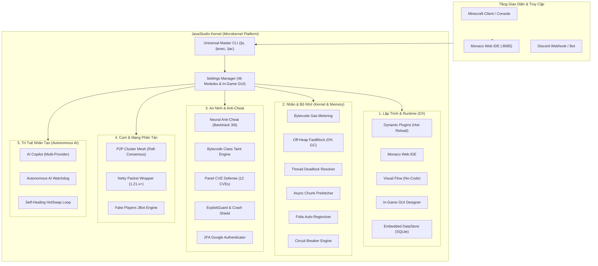
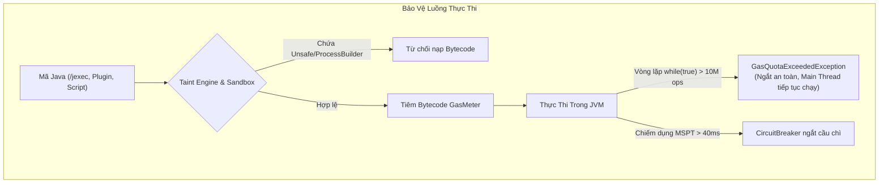
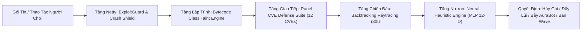
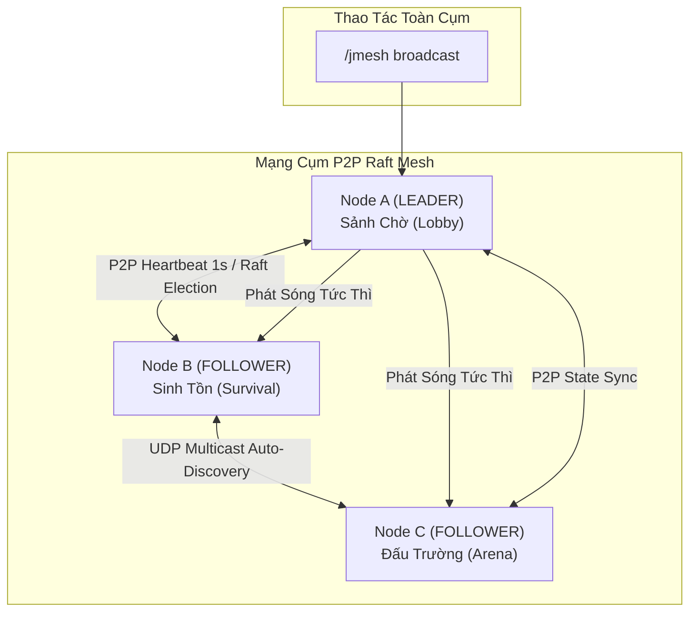

# 🚀 JavaStudio — Enterprise JVM Application Server & Runtime Engine

[](https://openjdk.org/)
[](https://papermc.io/)
[](https://www.minecraft.net/)
[]()
[]()

**JavaStudio** là một **Application Server & Runtime Engine** cấp doanh nghiệp nằm trực tiếp bên trong JVM của Minecraft. Vượt xa khỏi khuôn khổ của một plugin truyền thống, JavaStudio biến máy chủ Minecraft thành một môi trường phát triển (IDE), thực thi (Runtime), bảo mật (Anti-Cheat & CVE Defense), điều phối cụm mạng (P2P Raft Mesh) và tự động vận hành (Autonomous AI Watchdog) toàn diện với triết lý **Zero External Dependencies** (100% Java thuần).

---



---

## 📑 Mục Lục Hệ Thống (Table of Contents)

* [📌 Tổng Quan & Cài Đặt Nhanh](#-tổng-quan--cài-đặt-nhanh)
* [💻 PHẦN I: Trải Nghiệm Lập Trình & Môi Trường Runtime (DX & Runtime)](#-phần-i-trải-nghiệm-lập-trình--môi-trường-runtime-dx--runtime)
* [⚡ PHẦN II: Kiến Trúc Cốt Lõi, An Toàn Luồng & Tối Ưu Bộ Nhớ (Kernel & Memory)](#-phần-ii-kiến-trúc-cốt-lõi-an-toàn-luồng--tối-ưu-bộ-nhớ-kernel--memory)
* [🛡️ PHẦN III: Hệ Thống An Ninh Đa Tầng & Anti-Cheat (Enterprise Security)](#-phần-iii-hệ-thống-an-ninh-đa-tầng--anti-cheat-enterprise-security)
* [🌐 PHẦN IV: Cụm Máy Chủ Phân Tán & Mạng Đa Server (Cluster Mesh & Networking)](#-phần-iv-cụm-máy-chủ-phân-tán--mạng-đa-server-cluster-mesh--networking)
* [🤖 PHẦN V: Trí Tuệ Nhân Tạo & Tự Động Hóa Vận Hành (AI & Autonomous Ops)](#-phần-v-trí-tuệ-nhân-tạo--tự-động-hóa-vận-hành-ai--autonomous-ops)
* [⚙️ PHẦN VI: Quản Trị Cài Đặt Toàn Diện (46 Kernel Modules & In-Game GUI)](#-phần-vi-quản-trị-cài-đặt-toàn-diện-46-kernel-modules--in-game-gui)
* [📋 PHẦN VII: Bảng Tra Cứu Bộ Lệnh Toàn Diện (Universal Master Commands)](#-phần-vii-bảng-tra-cứu-bộ-lệnh-toàn-diện-universal-master-commands)
* [🧰 PHẦN VIII: JavaStudio High-Level Frameworks API (Dành Cho Dev)](#-phần-viii-javastudio-high-level-frameworks-api-dành-cho-dev)
* [🔨 PHẦN IX: Hướng Dẫn Biên Dịch & Đóng Gói (Build Instructions)](#-phần-ix-hướng-dẫn-biên-dịch--đóng-gói-build-instructions)

---

## 📌 Tổng Quan & Cài Đặt Nhanh

### 1. Ma Trận Khả Năng Tương Thích (Compatibility Matrix)

| Thành Phần | Yêu Cầu Hỗ Trợ | Ghi Chú Kỹ Thuật |
| :--- | :--- | :--- |
| **Java Virtual Machine** | **Java 21 LTS, 22, 23, 24, 25, 26+** | Khuyến nghị JDK 21+ để hỗ trợ `javax.tools.JavaCompiler` trực tiếp trong RAM. |
| **Server Software** | **Paper, Purpur, Folia, Spigot** | Tự động thích ứng đa luồng theo vùng (Regionized Multi-threading) trên Folia. |
| **Minecraft Protocol** | **1.20.5 – 1.21.x – 26.3+** | Hỗ trợ đầy đủ Custom Data Components (thay thế hoàn toàn NBT cũ). |
| **Dependencies** | **0 External Dependencies** | Không cần ProtocolLib, không cần Vault, không cần thư viện ngoài. |

### 2. Cài Đặt Nhanh Trong 3 Bước

1. Tải bản dựng `JavaStudio-1.0.0.jar` từ thư mục `target/` hoặc tự biên dịch bằng lệnh `.\build.ps1`.
2. Thả file vào thư mục `plugins/` của máy chủ Minecraft (Paper, Purpur, Folia hoặc Spigot).
3. Khởi động server. JavaStudio sẽ tự động thiết lập toàn bộ cấu trúc thư mục làm việc:
   ```text
   plugins/JavaStudio/
   ├── config.yml           # Cấu hình chi tiết toàn diện
   ├── modules.yml          # Kiến trúc Microkernel (Bật/Tắt 46 modules)
   ├── projects/            # Thư mục mã nguồn Dynamic Plugins (.java)
   ├── scripts/             # Thư mục QuickScripts Java độc lập
   ├── flows/               # Sơ đồ khối logic trực quan No-Code (.json)
   ├── guis/                # Thiết kế Chest GUI kéo-thả (.gui.json)
   ├── replays/             # Lịch sử và bằng chứng Ghost Replay 3D (.json)
   ├── exports/             # File JAR độc lập được xuất ra
   ├── storage.db           # Cơ sở dữ liệu SQLite DataStore tích hợp sẵn
   └── logs/                # Nhật ký kiểm toán an ninh, Thread Dump và crash
   ```

---

## 💻 PHẦN I: Trải Nghiệm Lập Trình & Môi Trường Runtime (DX & Runtime)

JavaStudio biến Minecraft thành một IDE thực thụ, cho phép lập trình viên và quản trị viên viết mã nguồn, thử nghiệm và xuất bản plugin mà không cần khởi động lại máy chủ.

### 1. Dynamic Plugins Engine (`/jplugin`)
* **Biên dịch & Nạp Nóng trong RAM**: Nạp trực tiếp mã nguồn từ `projects/<Tên>/` vào JVM chỉ trong vài chục mili-giây qua `DynamicClassLoader`.
* **Bảo Tồn Trạng Thái (@Persist)**: Gắn annotation `@Persist` lên bất kỳ trường dữ liệu (field) nào để giữ nguyên giá trị khi reload plugin (không bị reset điểm, biến, cache).
* **Kiểm Thử Tự Động In-Game (@Test)**: Viết các hàm `@Test` trong plugin; gõ `/jplugin test <tên>` để chạy unit test trực tiếp trong game với báo cáo thời gian nano-giây.

```java
package com.javastudio.projects;

import com.javastudio.api.DynamicPlugin;
import com.javastudio.api.annotation.Persist;
import com.javastudio.api.annotation.Test;
import org.bukkit.entity.Player;

public class CoinEconomy extends DynamicPlugin {

    @Persist
    private int totalTransactions = 0;

    @Override
    public void onEnable() {
        getLogger().info("CoinEconomy đã kích hoạt!");
    }

    @Test
    public void testDeposit() {
        assert 1 + 1 == 2 : "Phép tính cơ bản thất bại";
    }
}
```

### 2. Hot-Reload File Watcher
* Sử dụng `java.nio.file.WatchService` chạy ngầm. Khi bạn mở thư mục `projects/` bằng VS Code / IntelliJ và nhấn **`Ctrl + S`**, JavaStudio lập tức nhận diện thay đổi, biên dịch và nạp lại plugin trong game trong vòng <1 giây.
* Lệnh: `/javastudio watcher [on|off]`

### 3. Monaco Cloud Web IDE & Security Dashboard Nhúng (`:8085`)
* **Bảo Mật Zero-Trust Mặc Định**: Lắng nghe trên `127.0.0.1` theo mặc định, tự động sinh mã `auth-token` ngẫu nhiên 48 ký tự mật mã (`SecureRandom`) ở lần chạy đầu, xác thực `MessageDigest.isEqual` chống timing-attack trên mọi endpoint `/api/*`, giới hạn kích thước gói tin chống OOM và tự động khóa IP brute-force.
* **Giao diện VS Code Web & Reflection IntelliSense**: Mở trình duyệt tại `http://127.0.0.1:8085/anticheat` (Tab **Web IDE**) để lập trình trên nền Monaco Editor với dark theme, minimap, gợi ý hàm thời gian thực qua `/api/ide/autocomplete` và biểu đồ CPU FlameGraph trực tiếp tại `/api/profiler/flamegraph`.
* **Cây Thư Mục & Dry-Run Compile**: Quản lý danh sách file trong `projects/` và `scripts/`. Khi bấm `Ctrl + S`, server tự động biên dịch thử nghiệm (dry-run syntax check) và thông báo dòng/cột bị lỗi ngay trên thanh Dock chẩn đoán.
* **1-Click Actions**: Nút **Lưu & Biên Dịch**, **Chạy Script**, **Hot-Reload** trực tiếp từ trình duyệt.

### 4. Visual Flow Engine (`/jflow` — Lập Trình No-Code Blueprint)
* Thiết kế kịch bản logic máy chủ thông qua sơ đồ khối trực quan (Triggers, Conditions, Actions) mà không cần viết một dòng mã Java nào:
  * **Triggers**: `on_player_join`, `on_chat`, `on_damage`, `on_player_kill`, `on_sneak`, `manual`.
  * **Conditions**: `chance`, `has_permission`, `is_sneaking`, `health_below`.
  * **Actions**: `broadcast`, `send_title`, `play_sound`, `heal`, `give_item`, `execute_command`.
* **Web Visual Node Canvas Editor (:8085)**: Trình biên tập Node Blueprint tương tác đồ họa trực tiếp trên Web Dashboard với lưới canvas, kéo thả thẻ node, dây nối cong Bézier SVG, bảng thuộc tính trực quan, 1-click lưu và nạp nóng (`/api/flow/save`, `/api/flow/run`).
* **Graph-to-Java Compiler**: Tự động chuyển đổi file JSON trong `flows/` thành mã nguồn Java `QuickScript` chuẩn và nạp nóng vào máy chủ.
* Lệnh: `/jflow list`, `/jflow run <id>`, `/jflow reload`.

### 5. Visual In-Game GUI Designer (`/jgui designer`)
* Mở bàn thiết kế menu rương trực quan trong game: `/jgui designer <tên_gui> [1-5 hàng] [tiêu_đề]`.
* Kéo thả trực tiếp vật phẩm từ túi đồ vào các ô mong muốn.
* Nhấn **`Shift + Chuột Phải`** vào bất kỳ ô nào để cài đặt sự kiện: Lệnh người chơi, Lệnh console (`%player%`), Gửi tin nhắn, Phát âm thanh, Đóng menu.
* **Tự sinh mã nguồn Java 1-click**: Tự động xuất file mã nguồn Java hoàn chỉnh dùng `SmartGui` & `ItemBuilder` tại `projects/<Id>Gui.java`.

### 6. Thực Thi Java Trực Tiếp & Interactive Chat REPL (`/jexec`, `/java repl`)
* **Chạy mã Java tức thì**:
  ```bash
  /jexec player.sendMessage("§aXin chào " + player.getName());
  /jexec -a Bukkit.broadcastMessage("§eChạy bất đồng bộ (Async)");
  /jexec -t for(int i=0; i<1000; i++) Math.sqrt(i); # Đo thời gian nano-giây
  ```
* **Interactive In-Game REPL**: Chuyển kênh chat Minecraft thành terminal tương tác Java. Hỗ trợ khối đa dòng `{ ... }`, tự động lưu biến, gõ `history` để xem lịch sử và `undo` để hoàn tác biến.

### 7. Time-Travel Snapshot & Rollback Engine (`/jgit`)
* Hệ thống quản lý phiên bản mã nguồn cục bộ:
  * `/jgit snapshot [nhãn]`: Lưu ảnh toàn bộ mã nguồn của các plugin và script.
  * `/jgit rollback <id>`: Hoàn tác tức thì mã nguồn về checkpoint cũ an toàn.
  * `/jgit list` & `/jgit diff <id>`: Xem lịch sử và so sánh chi tiết thay đổi.

### 8. Mock Event Dispatcher Engine (`/jmock`)
* Giả lập bắn các sự kiện Bukkit in-game để kiểm thử logic plugin tự động:
  ```bash
  /jmock event join                  # Bắn giả lập PlayerJoinEvent
  /jmock event quit                  # Bắn giả lập PlayerQuitEvent
  /jmock event chat "Tin nhắn test"   # Bắn giả lập AsyncPlayerChatEvent
  /jmock event break                 # Bắn giả lập BlockBreakEvent
  ```

### 9. Tích Hợp DataStore & Database Inspector (`/jdb`)
* Mọi plugin đều có sẵn `getDataStore()` hỗ trợ Key-Value và SQLite `storage.db`:
  ```java
  getDataStore().set("player." + p.getUniqueId() + ".level", 50);
  int level = getDataStore().getInt("player." + p.getUniqueId() + ".level", 1);
  ```
* Lệnh `/jdb query <plugin> <sql>`: Truy vấn trực tiếp SQL trên database và in bảng kết quả ASCII ngay trong game.

### 10. Tự Động Phân Giải Thư Viện Maven Central & Marketplace (`/jplugin market`)
* Tự động tải các thư viện Maven Central (`com.google.code.gson`, `org.apache.commons`...) khai báo trong `dependencies` mà không cần cài thêm thủ công.
* Kho dự án mẫu 1-click: `/jplugin market install auto-broadcast`, `anti-afk`, `leaderboard`, `custom-boss`.

### 11. Xuất Plugin JAR Độc Lập, Bytecode Obfuscator & Licensing (`/jlicense`, `/jplugin export`)
* Xuất dynamic plugin thành file JAR tiêu chuẩn chạy trên mọi server Minecraft độc lập mà không cần cài JavaStudio:
  ```bash
  /jplugin export MyMinigame --obfuscate --license LIC-PRO-2026
  ```
* **Bytecode Obfuscator**: Gỡ bỏ toàn bộ `LineNumberTable`, `LocalVariableTable`, `SourceFile` để chống dịch ngược qua JD-GUI/Recaf.
* **Commercial Licensing Guard (`/jlicense`)**: Mã hóa HMAC-SHA256, khóa theo IP/Port và nhúng thủy vân chống rò rỉ (Anti-Leak Watermarking).

---

## ⚡ PHẦN II: Kiến Trúc Cốt Lõi, An Toàn Luồng & Tối Ưu Bộ Nhớ (Kernel & Memory)



### 1. Lexical & Tick-Synced Gas Metering (`GasMeter` & `LoopWatchdog`)
* **Vấn đề trên Java 21+**: Phương thức `Thread.stop()` đã bị cấm hoàn toàn. Nếu người dùng chạy `/jexec while(true);` hoặc hàm đệ quy cấp số nhân `fib(55)` trên Main Thread, các bộ lọc regex cũ hoặc luồng Watchdog ngoài không thể cứu máy chủ.
* **Giải pháp của JavaStudio**: Bộ phân tích từ vựng Java (Token-Aware Lexical Scanner) bỏ qua chuỗi/text-block và tự động chèn nhịp kiểm tra Gas vào mọi vòng lặp (`while`, `for`, `do`, kể cả vòng lặp không ngoặc nhọn `while(true);`, `for(;;);`) lẫn thân hàm đệ quy. Đồng bộ trực tiếp với nhịp Server Tick trên Primary Thread giúp `/jexec` gọi hợp lệ toàn bộ Bukkit/Paper API mà vẫn ngắt an toàn tuyệt đối bằng `GasQuotaExceededException` ở 20.0 TPS.

### 2. FastBlockEngine & Quản Lý Bộ Nhớ 100% Off-Heap Direct RAM (`/jchunk`)
* **100% Off-Heap Direct Memory**: Sử dụng `ByteBuffer.allocateDirect` lưu trữ cả **bảng từ điển Palette** lẫn **dữ liệu khối nén** của đấu trường ở vùng nhớ Native ngoài JVM Heap, đồng thời giải phóng tức thì khi ghi đè/xóa snapshot hoặc hoàn tác.
* **0% GC Overhead**: Hàng triệu khối nén nằm ngoài tầm kiểm soát của Garbage Collector (G1GC/ZGC), triệt tiêu hoàn toàn hiện tượng khựng hình (GC Pause).
* **Nén Bảng Màu (Palette Compression) + LZ77**: Đấu trường 100.000 khối chỉ tiêu tốn 15 KB – 40 KB RAM.
* **Hệ Thống Lệnh `/jchunk`**:
  ```bash
  /jchunk pos1 & /jchunk pos2        # Chọn 2 góc tọa độ 3D
  /jchunk fill <Material>            # Lấp đầy khối siêu tốc không lag
  /jchunk snapshot <tên>             # Lưu trạng thái đấu trường vào Off-Heap RAM
  /jchunk restore <tên>              # Khôi phục nguyên vẹn đấu trường trong <10ms
  /jchunk undo & /jchunk redo        # Hoàn tác / Làm lại thao tác khối
  /jchunk export <tên> <file>        # Xuất ra file đĩa cứng .jchunk
  ```

### 3. Autonomous Deadlock & Lock-Inversion Resolver
* Định kỳ chạy nền kiểm tra bế tắc luồng qua JVM `ThreadMXBean.findDeadlockedThreads()`.
* Khi phát hiện deadlock giữa các luồng nền, database hoặc dynamic plugin, hệ thống tự động phân tích đồ thị chu trình khóa và ngắt an toàn luồng worker không cốt lõi (`Thread.interrupt()`), giải tỏa bế tắc mà **không làm sập server**, cứu máy chủ khỏi Watchdog Crash ("Server hang").

### 4. Asynchronous Parallel Chunks Prefetcher (`/jprefetch`)
* Theo dõi tọa độ, vận tốc $(v_x, v_z)$ và góc nhìn của người chơi khi di chuyển tốc độ cao (Elytra, thuyền băng xanh, phi ngựa).
* Tự động dự đoán vector chuyển động và nạp trước các chunk phía trước bất đồng bộ (Off-Main-Thread) qua Paper Async Chunk API.
* Tích hợp bộ điều tiết TPS: Tự động giảm bán kính nạp hoặc hoãn tác vụ khi TPS < 18.0 hoặc MSPT > 45ms.
* Lệnh: `/jprefetch status`, `/jprefetch toggle`, `/jprefetch reset`.

### 5. Self-Attaching HotSwap Runtime Bytecode Engine
* Tự động đóng gói `JavaStudioAgent` nội bộ và gắn vào tiến trình JVM hiện tại qua `VirtualMachine.attach(pid)` mà không cần thư viện ngoài. Khi chỉnh sửa nội bộ phương thức, bytecode được nạp đè tức thì qua `Instrumentation.redefineClasses` mà **không cần unload plugin, không hủy listener, và giữ nguyên 100% dữ liệu biến** (tự động fallback sang Dynamic Reload nếu thay đổi cấu trúc lớp).

### 6. Folia Auto-Regionizer (`FoliaAutoRegionizer`)
* Tự động nhận diện môi trường Folia. Mọi thao tác khối, thực thể trong dynamic plugin được chuyển hướng tự động và trong suốt tới đúng `RegionScheduler` hoặc `EntityScheduler`, giúp mã nguồn Paper truyền thống chạy mượt trên Folia mà không ném lỗi `Thread failed main thread check`.
* **Phân Mảnh Vùng Đa Chunk Song Song (Cross-Region Parallel Chunk Processing)**: Tự động chia nhỏ khối Cuboid (`runInCuboid`) và nạp chunk bất đồng bộ an toàn (`runAtChunkAsync`), cho phép `FastBlockEngine` và cơ chế khôi phục snapshot thực thi song song trên từng thread khu vực của Folia mà không gây nghẽn luồng hay vi phạm ranh giới tiểu vùng.

### 7. Circuit Breaker & Exception Flight Recorder (`/jtrace`)
* Bọc trực tiếp tầng `EventExecutor` bên trong Bukkit `HandlerList`.
* Mô hình 3 trạng thái (`CLOSED`, `OPEN`, `HALF_OPEN`): Khi một Listener của bất kỳ plugin nào ném quá 15 lỗi/giây hoặc chiếm dụng Main Thread >40ms trong 5 lần liên tiếp, cầu chì tự động ngắt mạch (`OPEN`), cách ly listener đó để bảo vệ server.
* **Hộp Đen Ngoại Lệ (Flight Recorder)**: Chụp lại toàn bộ giá trị biến của `Event` và `Listener` tại khoảnh khắc nảy sinh lỗi vào RingBuffer.
* Lệnh: `/jtrace breakers`, `/jtrace dump latest`, `/jtrace reset all`.

### 8. Telemetry Nexus & AutoMitigation Engine (`/jdiag`)
* Giám sát liên tục TPS, MSPT, rò rỉ Metaspace ClassLoader và CPU.
* **Chế Độ Ứng Cứu Quá Tải Tự Động (Auto-Mitigation)**: Khi máy chủ bị quá tải (MSPT > ngưỡng cấu hình), hệ thống tự động dọn quái vật dư thừa, kích hoạt dọn rác RAM, giảm View Distance và tự động khôi phục lại cấu hình ban đầu khi server ổn định.

### 9. Server Capability & Hardware Benchmark Engine (`/jbench`, `/jtest`, `/servertest`)
* **Công Cụ Kiểm Thử Sức Mạnh Toàn Diện Ngay Khi Cài Đặt**: Giúp chủ máy chủ đo lường chính xác năng lực thực tế của CPU, RAM, NVMe, bộ điều phối tác vụ và khả năng biên dịch bytecode.
* **Quy Trình Stress-Test Đa Tầng**:
  1. **CPU Math Logic**: Đo tốc độ xử lý tính toán số học trên đơn nhân ($>80$ Triệu phép tính/giây).
  2. **Multi-Thread Crypto**: Băm HMAC-SHA256 song song trên hàng chục **Project Loom Virtual Threads** ($>500$ MB/s).
  3. **Direct Memory RAM**: Đo băng thông đọc/ghi vùng nhớ **Off-Heap Direct ByteBuffer** ngoài JVM Heap ($>20$ GB/s).
  4. **Storage NVMe / SSD I/O**: Đo tốc độ đọc/ghi ngẫu nhiên và tuần tự trên ổ cứng lưu trữ thế giới Minecraft ($>800$ MB/s).
  5. **In-Memory RuntimeCompiler**: Kiểm tra thời gian biên dịch mã nguồn Java live trong RAM ($<80$ ms).
  6. **Event Pipeline Bus Throughput**: Giả lập bắn sự kiện Bukkit tốc độ cao ($>1.000.000$ events/s).
  7. **Scheduler Micro-Jitter**: Lấy mẫu độ trễ và độ lệch nhịp đồng hồ nano ($<0.05$ ms).
* **Hệ Thống Chấm Điểm Hiệu Năng Chuẩn Hóa (JSPI - JavaStudio Performance Index)**:
  * Điểm số từ 0 đến 15,000 điểm, tự động phân hạng:
    * 👑 **Tier SSS (>= 9,000 pts)**: Cấp độ Siêu Cụm (Super-Cluster), chịu tải 500+ người chơi online, View Distance 16 chunks.
    * 💎 **Tier SS (>= 7,000 pts)**: Cấp độ Cực Cao (Ultra-Performance), chịu tải 300 - 450 người chơi, View Distance 12 chunks.
    * 🌟 **Tier S (>= 5,000 pts)**: Cấp độ Xuất Sắc (Production High), chịu tải 150 - 300 người chơi, View Distance 10 chunks.
    * ⚡ **Tier A (>= 3,500 pts)**: Tiêu Chuẩn Vận Hành (Production Standard), chịu tải 80 - 150 người chơi, View Distance 8 chunks.
    * ⚠️ **Tier B (>= 2,000 pts)**: Cấu hình Trung Bình (Medium Server), phù hợp 30 - 80 người chơi, View Distance 6 chunks.
    * 🚨 **Tier C (< 2,000 pts)**: Cấu hình Yếu, cảnh báo nghẽn I/O ổ đĩa hoặc thiếu vCPU, khuyến nghị nâng cấp phần cứng.
* **Tự Động Đưa Ra Khuyến Nghị Cấu Hình**: Đề xuất số lượng người chơi online tối đa, View Distance và Simulation Distance tối ưu, đồng thời chỉ ra chính xác các điểm nghẽn (RAM Heap thấp, ổ đĩa HDD chậm, JRE thay vì JDK).
* **Tích Hợp Web Dashboard**: Tab `⚡ Server Benchmark` hiển thị biểu đồ điểm số, thông số từng bài đo, thẻ trạng thái động và nút bấm 1-click khởi chạy kiểm thử từ xa.
* **Lệnh Thao Tác**:
  ```bash
  /jbench run           # Bắt đầu kiểm tra và chấm điểm toàn diện server
  /jbench quick         # Đo nhanh trong 2 giây (Quick Benchmark)
  /jbench report        # Xem lại kết quả và khuyến nghị chi tiết gần nhất
  /jbench info          # Xem thông tin phần cứng CPU, RAM, JVM và OS
  /js bench [subcmd]    # Gọi qua Universal Master Command
  ```

---

## 🛡️ PHẦN III: Hệ Thống An Ninh Đa Tầng & Anti-Cheat (Enterprise Security)



### 1. Bytecode Constant-Pool Class Taint Engine
* Phân tích nhị phân bytecode `.class` trực tiếp (Zero external ASM).
* Quét tìm và chặn đứng từ tầng nhị phân mọi lệnh nguy hiểm: `sun.misc.Unsafe`, `ProcessBuilder`, `Runtime.exec`, `System.exit`, `AccessibleObject.setAccessible`, `MethodHandles.privateLookupIn`. Dù mã bị xáo trộn regex tinh vi đến đâu, class chứa lệnh cấm đều bị từ chối nạp vào JVM.

### 2. Panel & Wings CVE Defense Suite (`/jsecurity cve`)
Phòng thủ chủ động 12 CVEs khai thác hạ tầng Hosting Panel (Pterodactyl, Crafty, Wings):

| CVE / Advisory | CVSS | Loại Lỗ Hổng | Cơ Chế Phòng Thủ Của JavaStudio |
| :--- | :--- | :--- | :--- |
| **CVE-2025-14700** | **9.9 Critical** | SSTI → RCE qua Webhook Template | `SstiDefenseFilter`: Vô hiệu hóa Jinja2 (`{{...}}`, `__globals__`, `os.popen`) và Reverse Shell script. |
| **CVE-2026-0963** | **9.9 Critical** | Path Traversal File Operations API | `PathTraversalDefense`: Bắt buộc Canonical Path Verification, chặn `%00` và `..`. |
| **CVE-2026-13716** | **9.1 Critical** | Nested Path Traversal `.../...//` | Khử đệ quy và triệt tiêu các biến thể lồng nhau, chống Zip Slip khi nạp template. |
| **CVE-2025-49132** | **10.0 Critical** | Unauth RCE qua `pearcmd.php` LFI | `PterodactylLfiHoneypot`: Đặt bẫy decoy `/locales/locale.json`, khóa IP kẻ tấn công ngay lập tức. |
| **CVE-2024-27102** | **10.0 Critical** | Wings Sandbox Escape & Symlink | `WingsSandboxBoundaryGuard`: Giám sát ranh giới container root, cấm symlink ra `/etc/passwd`. |
| **CVE-2025-14701** | **7.1 High** | Stored XSS qua Server MOTD | `MotdXssGuardListener`: Làm sạch thẻ HTML `<script>`, `javascript:` trong gói ping MOTD. |
| **CVE-2024-1064** | **7.5 High** | Host Header Injection | `HostHeaderValidator`: Thẩm định HTTP Host Header theo RFC 7230, chặn CRLF injection. |

### 3. ExploitGuard & Crash Packet Defense (`/jexploit`)
* Chặn đứng các loại gói tin crash server trước khi vào Main Thread: Sách độc nén NBT quá tải, Sign Text Overflow, Tọa độ NaN / Vô cực (>30,000,000m), Boat Fly, và cú pháp phá hoại WorldEdit (`//calc`, `/worldedit:/calc`).

### 4. Hệ Thống Anti-Cheat Đẳng Cấp Cao (`/jac`)

#### A. Ma Trận Mốc Người Chơi Chuẩn Hóa
| Hạng Mục | Người Thường | Tuyển Thủ Pro PvP | 100% Hack / Cheat | Thuật Toán & Cơ Chế Phát Hiện |
| :--- | :--- | :--- | :--- | :--- |
| **Reach (Tầm với)** | 2.60m – 2.90m | 2.95m – 3.00m | **> 3.45m** | `AcUtil.distanceToBox` + Backtracking 30 ticks + bù Ping. |
| **AutoClicker (CPS)** | 6 – 10 CPS | 12 – 20 CPS | **> 22 CPS** | Đếm xung click `ArrayDeque<Long>`, đo nhịp bấm qua cửa sổ trượt. |
| **Click Variance** | 15ms – 40ms | 6.0ms – 15ms | **< 4.2ms** (Đều như máy gõ nhịp) | `AcUtil.standardDeviation` tính độ lệch chuẩn khoảng cách click. |
| **Aim GCD (Góc quay)** | $0.005$ – $0.08$ | $0.005$ – $0.08$ | **$< 0.0009$** (Góc quay siêu mượt) | Phân tích ước chung lớn nhất `AcUtil.gcd` trên chuỗi vi sai Pitch/Yaw. |
| **KillAura Angle** | $0^\circ$ – $30^\circ$ | $30^\circ$ – $55^\circ$ | **$> 70^\circ$** hoặc quay lưng | Tính góc lệch vector nhìn và vector mục tiêu. |
| **Multi-Switch** | 200ms – 400ms | 100ms – 150ms | **$< 65ms$ cho góc $> 50^\circ$** | Đo delta góc và thời gian chuyển đổi mục tiêu giữa 2 đòn đánh. |
| **Scaffold (Bắt cầu)**| Đi lùi + Shift | FastBridge nhìn khối | **Sprint không sneak, offY=-1** | Raycast tầm nhìn, kiểm tra vector chuyển động và hủy đặt khối. |

#### B. Các Công Nghệ Anti-Cheat Đột Phá Hàng Đầu
1. **Server-Side Backtracking Raytracing (RingBuffer 30 ticks)**:
   * Khi người chơi đánh, động cơ tính ngược thời gian theo Ping: $\Delta t = t_{\text{hiện tại}} - \frac{\text{ping}}{2}$.
   * Tái dựng chính xác hộp va chạm `BoundingBox` của nạn nhân trong quá khứ và phóng tia raycast (Slab Method). Triệt tiêu 100% báo động giả do giật lag mạng.
2. **Neural Heuristic Engine (Edge AI Mạng Nơ-ron MLP 12 Chiều)**:
   * Mạng nơ-ron truyền thẳng tính toán vector 12 chiều trong bộ nhớ RAM với thời gian phản hồi **<15 microseconds** (Zero Garbage Allocation). Nhận diện chính xác Killaura nhân tạo và AimAssist máy móc.
3. **Exact Physics Simulation Engine**:
   * Mô phỏng vector trọng lực chuẩn Vanilla: $v_{y, \text{next}} = (v_{y, \text{prev}} - 0.08) \times 0.98$.
   * Bắt trọn 100% các hành vi AirJump, Mid-air Hover, Step, FastFall, và kiểm tra phản lực Knockback (chống 0-KB / Anti-Knockback).
4. **Bẫy AuraBot Tàng Hình (Invisible AuraBot Trap)**:
   * Triệu hồi một thực thể tàng hình bay bám sát **điểm mù 180° sau lưng** nghi phạm. Mắt người thật không nhìn thấy, nhưng các client cheat (Killaura, MobAura) sẽ tự động quay ngoắt 180° chém bẫy $\rightarrow$ Bắt quả tang 100% không báo động sai.
5. **Bẫy Quặng Ảo (Honeypot Ore Engine)**:
   * Gán bẫy quặng kim cương/Netherite ngầm kín 6 mặt trong lòng đất. Người thường không thể đào thấy; hacker dùng X-Ray / Freecam bẻ góc đào thẳng vào bẫy sẽ bị bắt ngay lập tức.
6. **In-Game Ghost Replay & Web Replay Visualizer (`/jac replay`)**:
   * Lưu toàn bộ quỹ đạo chuyển động 400 ticks (20 giây) vào file `.json`.
   * Chiếu lại hiện trường 3D bằng Ghost Mannequin trong game (`/jac replay play <id>`) hoặc xem quỹ đạo 2D trực quan trên Web Dashboard tại `:8085`.
7. **Hệ Thống Tố Cáo Thông Minh (`/report`) & Ban Wave**:
   * Người chơi gõ `/report <người_chơi> <lý do>` $\rightarrow$ Tự động tăng 50% độ nhạy kiểm tra, triệu hồi AuraBot theo dõi, lưu clip replay và thông báo cho Staff + Discord.
   * Gom đối tượng vi phạm vào hàng đợi thanh trừng và ban hàng loạt theo đợt (`/jac wave execute`).

### 5. Khóa Bảo Mật Hai Lớp TOTP 2FA (`/j2fa`, `/jsecurity totp`)
* Chuẩn RFC 6238 TOTP thời gian thực (time-step 30 giây).
* Vẽ bản đồ QR Code in-game trao tận tay Admin để quét vào ứng dụng Google Authenticator / Authy.
* Bắt buộc xác thực `/j2fa verify <6_số>` trước khi được phép chạy các lệnh nhạy cảm (`/jexec`, `/jserver`).

---

## 🌐 PHẦN IV: Cụm Máy Chủ Phân Tán & Mạng Đa Server (Cluster Mesh & Networking)



### 1. Cluster Mesh Engine (`/jmesh` — P2P Raft Consensus + HMAC-SHA256 + Distributed KV/Lock)
* **Không Cần Redis hay Database Ngoài**: Các máy chủ Paper/Purpur tự động tìm kiếm nhau qua mạng LAN/WAN hoặc `mesh-seeds`, mọi gói tin P2P đều được ký số **HMAC-SHA256** kèm chống phát lại (anti-replay nonce + cửa sổ thời gian 30s).
* **Thuật Toán Bầu Chọn Raft Consensus**: Tự động bầu chọn node **LEADER** điều phối cụm không gây bão bầu cử khi chạy đơn lẻ (Standalone).
* **Distributed Key-Value & Distributed Lock**: Đồng bộ biến toàn cụm (`/jmesh kv set <k> <v>`) và khóa phân tán có Fencing Token (`/jmesh lock acquire <key> [ttl_ms]`) chống nhân bản vật phẩm/tiền tệ khi người chơi chuyển server.
* **Zero-Dupe Cross-Server Inventory Sync**: Đồng bộ túi đồ, giáp, offhand, rương Ender, máu, đói, cấp độ và hiệu ứng thuốc qua cụm phân tán P2P. Sử dụng Fencing Token Lock và mã băm SHA-256 Checksum đảm bảo không thể nhân bản (zero-dupe) và không mất đồ khi chuyển cụm máy chủ.
* Lệnh: `/jmesh status`, `/jmesh nodes`, `/jmesh broadcast <tin>`, `/jmesh kv <list|get|set|del>`, `/jmesh lock <list|acquire|release>`, `/jmesh sync <player>`, `/jmesh restore <player>`.

### 2. Redis RESP & Socket Multi-Server Sync (`/jnetwork`)
* Hỗ trợ giao thức Redis RESP thuần và kênh socket nội bộ để đồng bộ danh sách người chơi online, dữ liệu biến và lệnh quản trị trên mạng BungeeCord / Velocity.

### 3. Netty Packet Sniffer Cấp Thấp & Packet Wrappers 1.20.5 - 1.21.x+ (`/jpacket`)
* Bọc kênh `ChannelPipeline` trực tiếp ở tầng Netty mà không cần ProtocolLib.
* Hỗ trợ giải mã gói tin thời gian thực: vị trí, góc nhìn, đòn đánh, vận tốc.
* Lệnh: `/jpacket on`, `/jpacket off`, `/jpacket filter <từ_khóa>`, `/jpacket status`.

### 4. JBotEngine: Giả Lập Người Chơi Ảo & Stress-Test (`/jbot`, `/jb`)
* Giả lập bot người chơi thật ở tầng Netty Channel (`EmbeddedChannel`) không cần mở thêm cửa sổ Minecraft client.
* Hỗ trợ các hành vi: `IDLE`, `WANDER` (đi lại ngẫu nhiên), `COMBAT` (tấn công liên tục để test Anti-Cheat), `SPAM_CHAT`.
* Chế độ Stress-Test: `/jbot mass <số_lượng>` triệu hồi hàng chục bot để kiểm tra độ chịu tải của server.

### 5. Embedded HTTP Resource Pack Server & JSON Generator (`/jpack`)
* Tích hợp máy chủ HTTP Virtual-Thread độc lập (cổng 8088, hỗ trợ `ETag` / `304 Not Modified` và giới hạn tốc độ tải theo IP). Tự động sinh manifest JSON chuẩn Minecraft (`models/item/*.json`, `sounds.json`, `font/default.json`), nén ZIP trong RAM, tính SHA-1 và ép tải qua `/jpack push [player|all]`.

---

## 🤖 PHẦN V: Trí Tuệ Nhân Tạo & Tự Động Hóa Vận Hành (AI & Autonomous Ops)

### 1. Trợ Lý AI Lập Trình Đa Nền Tảng (`/jai`)
* Hỗ trợ đa nhà cung cấp: **OpenAI** (`gpt-4o`), **Google Gemini** (`gemini-1.5-flash`), **Anthropic Claude** (`claude-3-5-sonnet`), và **Ollama** (Local LLM chạy offline trên máy chủ riêng hoàn toàn miễn phí).
* **Tự Động Sinh Mã Plugin**: `/jai create DiamondBoss "Khi đào kim cương có 15% triệu hồi Boss Zombie có kiếm sét"`.
* **Hỏi Đáp Lập Trình**: `/jai ask "Làm thế nào để tạo vật phẩm có CustomModelData?"`.
* **Tối Ưu Mã Nguồn**: `/jai optimize <tên_plugin>` chuyển đổi vòng lặp nặng sang `SmartScheduler` và `FastBlockEngine`.

### 2. Autonomous AI Watchdog Agent (`/jai watchdog`)
* Quét liên tục mỗi 5 giây: Giám sát TPS và độ tắc nghẽn luồng CPU chính (Thread Lock Contention).
* **Quy Trình Ứng Cứu Khẩn Cấp Tự Hành**:
  1. Khi TPS < 16.0 hoặc Main Thread bị khóa, Watchdog lập tức chụp toàn bộ **JVM Thread Dump**.
  2. Định vị chính xác class và số dòng code gây nghẽn luồng.
  3. Tự động dỡ bỏ (Unload) plugin thủ phạm để giải phóng luồng chính, đưa TPS máy chủ trở lại 20.0 ngay lập tức!
  4. Gửi Thread Dump cho `AiAssistant` phân tích nguyên nhân gốc rễ và thông báo cho Admin qua Discord.

### 3. AI Self-Healing Loop (`/jai autofix`)
* Tự động đọc Stacktrace lỗi biên dịch hoặc Runtime Exception gần nhất của Dynamic Plugin, sinh bản vá lỗi hoàn chỉnh và kích hoạt `HotSwapEngine` nạp nóng trực tiếp vào RAM mà không cần khởi động lại server.

### 4. Discord Webhook Logger & Remote Bridge (`/jbridge`)
* Tự động gửi cảnh báo vi phạm Anti-Cheat, cảnh báo mã độc và báo cáo sụt giảm TPS về kênh Discord Staff.
* Lệnh cứu hộ khẩn cấp từ xa: `/jbridge rescue <gc>` kích hoạt dọn rác RAM từ xa.

---

## ⚙️ PHẦN VI: Quản Trị Cài Đặt Toàn Diện (48 Kernel Modules & In-Game GUI)

> [!IMPORTANT]
> **Cam Kết Triệt Tiêu Tài Nguyên Tuyệt Đối (Zero-Overhead Disablement):**
> Khi bất kỳ phân hệ nào bị tắt trong cài đặt:
> * Tuyệt đối **không nạp Class**, không đăng ký Bukkit Event Listeners của phân hệ đó.
> * Tuyệt đối **không mở cổng Socket TCP, P2P UDP** hay HTTP Server.
> * Tuyệt đối **không khởi tạo luồng Timer/Scheduler** hay cấp phát vùng nhớ Off-Heap RAM.
> * Giải phóng 100% tài nguyên CPU, RAM và I/O mạng cho máy chủ!

### 1. Bảng Điều Khiển In-Game Chest GUI 54 Ô Phân Trang
* **Lệnh mở GUI**: `/javastudio settings` hoặc `/javastudio menu`
* **Giao diện trực quan**:
  * 🟢 **Lime Dye (Thuốc nhuộm xanh)**: Phân hệ đang BẬT.
  * ⚪ **Gray Dye (Thuốc nhuộm xám)**: Phân hệ đang TẮT.
  * **Thao tác 1-Click**: Nhấp chuột trái vào bất kỳ icon nào để **Bật/Tắt tức thì**. Hệ thống tự động cập nhật cấu hình và dừng/khởi chạy dịch vụ nền tương ứng ngay tại chỗ!

### 2. Ma Trận Toàn Bộ 46 Kernel Modules

| Khóa Cài Đặt (`config.yml` & `modules.yml`) | Tên Phân Hệ | Tài Nguyên Được Triệt Tiêu Hoàn Toàn Khi Tắt |
| :--- | :--- | :--- |
| `direct-exec` | Thực thi Java trực tiếp | Chặn gọi trình biên dịch chạy mã Java tức thì qua `/jexec`, `/java` |
| `dynamic-plugins` | Dynamic Plugins Engine | Không khởi tạo DynamicClassLoader, tiết kiệm Metaspace/RAM (`/jplugin`) |
| `script-manager` | Quản lý Scripts độc lập | Không quét và nạp file script trong `scripts/` (`/jscript`) |
| `plugin-controller`| Plugin Controller (PlugManX) | Không can thiệp vào ClassLoader hoặc danh sách plugin ngoài (`/jpm`) |
| `server-monitor` | Server Monitor & Dọn dẹp | Không lấy mẫu TPS/MSPT định kỳ, giải phóng tác vụ Main Thread (`/jserver`) |
| `file-watcher` | Hot-Reload File Watcher | Tắt thread WatchService, giảm 100% I/O ổ đĩa nền khi lưu file |
| `plugin-exporter` | Plugin Exporter | Không nạp công cụ đóng gói JAR độc lập (`/jplugin export`) |
| `discord-webhook` | Discord Webhook Logging | Không gửi HTTP Request ra ngoài Internet, tiết kiệm băng thông |
| `security-sandbox` | Security Sandbox Gatekeeper | Bỏ qua luồng Executor kiểm soát thời gian để chạy trực tiếp |
| `marketplace` | Chợ Plugin & Package Manager | Không nạp kho template dự án sẵn vào bộ nhớ RAM (`/jplugin market`) |
| `security-scanner` | Bộ quét mã độc Antivirus | Tiết kiệm CPU, không quét các file JAR trong `plugins/` |
| `bytecode-inspector`| Mổ xẻ Bytecode Disassembler | Không mở stream đọc file class khi không cần kiểm tra |
| `display-engine` | Hologram, Scoreboard, BossBar| Xóa toàn bộ Hologram và giải phóng bộ nhớ Scoreboard/BossBar |
| `interactive-repl` | Chat REPL tương tác | Không lắng nghe sự kiện chat để thông dịch mã Java (`/java repl`) |
| `network-sync` | Đồng bộ mạng đa server | **Không mở cổng Socket TCP**, không chạy listener đồng bộ ngầm |
| `plugin-profiler` | Plugin Profiler & Lag Monitor| Dừng đo latency và không tính toán thời gian nanosecond trên event |
| `redis-sync` | Đồng bộ cụm phân tán Redis | Đóng kết nối socket Redis và dừng luồng lắng nghe Subscriber ngầm |
| `exploit-fixer` | Bảo vệ chống Exploit | Không kích hoạt bộ lọc gói tin và không kiểm tra NBT/tọa độ (`/jexploit`) |
| `anti-cheat` | Hệ thống Anti-Cheat | Bỏ qua toàn bộ 35+ checks, giải phóng CPU Main Thread và Backtrack Buffer (`/jac`) |
| `auto-mitigation` | Ứng cứu quá tải tự động | Tắt giám sát tự động; không hạ tầm nhìn hay dọn quái khi lag (`/jdiag`) |
| `panel-cve-defense`| Phòng thủ CVEs Panel | Không lọc MOTD ping, không chạy bẫy Honeypot LFI (`/jsecurity cve`) |
| `ai-assistant` | Trợ lý lập trình AI Copilot | Không gọi API OpenAI/Claude/Ollama ra ngoài Internet (`/jai`) |
| `packet-sniffer` | Netty Packet Sniffer | Gỡ bỏ ChannelHandler, giải phóng 100% chi phí phân tích gói (`/jpacket`) |
| `resource-pack` | Máy chủ HTTP Resource Pack | Không mở HTTP Server cổng 8088 và không giữ ZIP trong RAM (`/jpack`) |
| `license-manager` | Quản lý Bản quyền & Thủy vân | Không chạy thuật toán băm HMAC-SHA256 kiểm tra license (`/jlicense`) |
| `fake-players` | Giả lập Người chơi ảo | Xóa bỏ toàn bộ bot ảo và dừng các tác vụ giả lập mạng bot (`/jbot`) |
| `heap-inspector` | Live Heap Inspector | Không duyệt cây đối tượng RAM và khóa tính năng sửa biến live (`/jheap`) |
| `remote-bridge` | Cầu nối điều hành từ xa | Dừng các tác vụ chuyển tiếp cảnh báo sự cố từ xa (`/jbridge`) |
| `two-factor-auth` | Xác thực 2 bước TOTP | Không yêu cầu xác thực Google Authenticator khi chạy lệnh nhạy cảm (`/j2fa`) |
| `circuit-breaker` | Cầu chì Circuit Breaker | Không bọc EventExecutor của Bukkit, tắt cúp cầu chì và hộp đen RAM (`/jtrace`) |
| `fast-block` | FastBlock & RAM Arena | Giải phóng toàn bộ bộ nhớ Off-Heap RAM lưu trữ snapshot đấu trường (`/jchunk`) |
| `debug-hud` | Debug HUD Thời gian thực | Dừng tác vụ cập nhật định kỳ trên ActionBar và BossBar (`/jhud`) |
| `event-spy` | Interactive Event Spy | Hủy toàn bộ Listener lắng nghe sự kiện Bukkit đang gỡ lỗi (`/jspy`) |
| `telemetry-nexus` | Telemetry Nexus & Diagnostics | Dừng tác vụ lấy mẫu thống kê TPS, MSPT, rò rỉ bộ nhớ Metaspace (`/jdiag`) |
| `cluster-mesh` | Cluster P2P Mesh Network | Không mở Socket Server P2P, không phát gói tin UDP Multicast tìm cụm (`/jmesh`) |
| `deadlock-resolver`| Deadlock & Thread Stall Resolver| Không chạy luồng JVM ThreadMXBean ngầm kiểm tra chu trình khóa |
| `chunk-prefetcher` | Async Parallel Chunk Prefetcher| Không chạy tác vụ dự đoán vector và nạp trước chunk ngầm (`/jprefetch`) |
| `gui-designer` | In-Game Visual GUI Designer | Không nạp trình thiết kế kéo-thả và không đăng ký bộ xử lý GUI click (`/jgui`) |
| `visual-flow` | Visual Flow No-Code Engine | Không nạp engine biên dịch sơ đồ nốt sang Java bytecode (`/jflow`) |
| `snapshot-rollback`| Time-Travel Snapshot & Rollback| Không tạo file điểm khôi phục mã nguồn và lịch sử phiên bản (`/jgit`) |
| `mock-events` | Mock Event Simulator | Không nạp engine giả lập bắn sự kiện Bukkit in-game (`/jmock`) |
| `database-query` | Live SQL & DataStore Inspector | Không mở kết nối truy vấn trực tiếp cơ sở dữ liệu dynamic plugin (`/jdb`) |
| `universal-command`| Universal Command Dispatcher | Không xử lý lệnh điều phối trung tâm gộp chung (`/js <phân_hệ>`) |
| `webide` | Monaco Cloud Web IDE (:8085) | Không nạp trình soạn thảo Monaco và endpoint WebSocket đồng bộ code web |
| `gas-meter` | Bytecode Gas Metering | Không tiêm bytecode đếm nhịp gas vào các vòng lặp `while(true)` |
| `hotswap-engine` | HotSwap Runtime Bytecode Engine| Không kích hoạt JVM Instrumentation agent để nạp đè bytecode trực tiếp |
| `inventory-sync` | Đồng bộ kho đồ cụm không dupe | Không kích hoạt phân hệ P2P Sync túi đồ, giáp, rương liên server (`/jmesh sync`) |
| `server-benchmark`| Đo lường & chấm điểm phần cứng | Không chạy các tác vụ stress-test CPU, RAM, NVMe và benchmark máy chủ (`/jbench`) |

---

## 📋 PHẦN VII: Bảng Tra Cứu Bộ Lệnh Toàn Diện (Universal Master Commands)

JavaStudio áp dụng **cấu trúc lệnh kép**: Bạn có thể gọi nhanh qua **Universal Master CLI (`/js <phân_hệ>`)** hoặc dùng trực tiếp các **Alias ngắn gọn**.

```bash
# Cú pháp gộp thông qua Master CLI:
/js <exec|plugin|script|gui|flow|git|mock|db|ai|prefetch|chunk|mesh|ac|exploit|trace|heap|bot|packet|settings> [tham_số...]
```

### Bảng Phân Nhóm 25+ Lệnh Chính & Quyền Hạn

| Nhóm Tính Năng | Lệnh Trực Tiếp | Lệnh Qua `/js` | Quyền Hạn (Permission) | Mô Tả Chức Năng |
| :--- | :--- | :--- | :--- | :--- |
| **Cài Đặt & Menu** | `/javastudio settings`<br>`/javastudio menu` | `/js settings` | `javastudio.admin` | Mở Chest GUI tương tác 54 ô bật/tắt tức thì 46 modules. |
| | `/javastudio toggle <mod>` | `/js toggle <mod>` | `javastudio.admin` | Bật/tắt nhanh 1 module cụ thể qua CLI/Console. |
| | `/javastudio list` | `/js list` | `javastudio.admin` | Xem trạng thái text của toàn bộ 46 modules. |
| **Lập Trình & Code** | `/jexec <code...>` | `/js exec <code...>` | `javastudio.admin` (OP) | Thực thi mã Java trực tiếp thời gian thực trong game. |
| | `/java repl` / `/jexec repl` | `/js repl` | `javastudio.admin` | Bật/tắt chế độ Chat REPL tương tác đa dòng. |
| | `/jplugin <subcmd>` | `/js plugin <subcmd>` | `javastudio.admin` | Quản lý dynamic plugins (create, reload, list, export, market). |
| | `/jscript <run\|list>` | `/js script <run>` | `javastudio.admin` | Quản lý và thực thi các file QuickScript trong `scripts/`. |
| | `/jflow <list\|run>` | `/js flow <run>` | `javastudio.admin` | Quản lý và thực thi sơ đồ khối No-Code Blueprint. |
| | `/jgui <designer\|open>` | `/js gui <designer>` | `javastudio.admin` | Thiết kế Chest GUI kéo-thả và xuất mã nguồn Java. |
| | `/jgit <snapshot\|rollback>`| `/js git <snapshot>` | `javastudio.admin` | Chụp checkpoint mã nguồn và hoàn tác tức thì. |
| | `/jmock event <name>` | `/js mock event` | `javastudio.admin` | Giả lập bắn sự kiện Bukkit in-game để unit test. |
| | `/jdb <query\|inspect>` | `/js db <query>` | `javastudio.admin` | Truy vấn SQL trực tiếp trên database của plugin con. |
| **Bảo Vệ & An Ninh** | `/jac <status\|alerts\|bot>` | `/js ac <subcmd>` | `javastudio.admin` | Quản trị toàn diện Anti-Cheat, xem vi phạm, thả bẫy AuraBot. |
| | `/jac replay <play\|list>` | `/js ac replay` | `javastudio.admin` | Xem lại hiện trường gian lận bằng Ghost Mannequin 3D. |
| | `/report <player> <lý_do>` | Không áp dụng | Mọi người chơi | Gửi đơn tố cáo nghi vấn hack cho Staff và kích hoạt tự động bẫy. |
| | `/jexploit <status\|stats>` | `/js exploit` | `javastudio.admin` | Quản lý phân hệ ExploitGuard và xem thống kê crash bị chặn. |
| | `/jsecurity cve <audit>` | `/js security cve` | `javastudio.admin` | Kiểm toán 12 CVEs Panel/Wings và quản trị Honeypot. |
| | `/j2fa <setup\|verify>` | `/js 2fa` | `javastudio.admin` | Thiết lập và xác thực 2 lớp Google Authenticator. |
| **Hiệu Năng & Chẩn Đoán**| `/jdiag <status\|mitigate>` | `/js diag` | `javastudio.admin` | Xem chẩn đoán TPS, MSPT, rò rỉ RAM và điều khiển giảm tải. |
| | `/jbench <run\|quick\|report>`| `/js bench` | `javastudio.admin` | Đo lường năng lực phần cứng, stress-test và chấm điểm server JSPI. |
| | `/jtrace <breakers\|dump>` | `/js trace` | `javastudio.admin` | Quản trị cầu chì Circuit Breaker và soi hộp đen ngoại lệ. |
| | `/jchunk <fill\|snapshot>` | `/js chunk` | `javastudio.admin` | Thao tác khối siêu tốc và lưu bản đồ vào Off-Heap RAM. |
| | `/jprefetch <status\|toggle>`| `/js prefetch` | `javastudio.admin` | Quản trị động cơ nạp trước chunk bất đồng bộ theo vector. |
| | `/jheap <get\|set\|sizeof>` | `/js heap` | `javastudio.admin` | Soi và sửa trực tiếp cây đối tượng trong bộ nhớ RAM JVM. |
| **Trí Tuệ Nhân Tạo** | `/jai <ask\|create\|chat>` | `/js ai <subcmd>` | `javastudio.admin` | Hỏi đáp kỹ thuật, tự động sinh code plugin bằng AI. |
| | `/jai watchdog <status>` | `/js ai watchdog` | `javastudio.admin` | Quản trị đặc vụ AI tự động bắt Thread Dump và cứu lag. |
| | `/jai autofix <plugin>` | `/js ai autofix` | `javastudio.admin` | Tự động phân tích lỗi stacktrace và vá nóng bằng AI. |
| **Cụm Mạng & Đa Server** | `/jmesh <status|nodes|sync|restore>`| `/js mesh` | `javastudio.admin` | Giám sát P2P cụm server, đồng bộ kho đồ Zero-Dupe, KV & Lock. |
| | `/jpacket <on\|filter>` | `/js packet` | `javastudio.admin` | Lắng nghe và phân tích gói tin mạng Netty cấp thấp. |
| | `/jbot <spawn\|mass>` | `/js bot` | `javastudio.admin` | Triệu hồi bot ảo kiểm thử tải và benchmark PvP. |
| | `/jpack <status\|push>` | `/js pack` | `javastudio.admin` | Quản lý máy chủ HTTP phát gói tài nguyên Resource Pack. |
| | `/jnetwork <status>` | `/js network` | `javastudio.admin` | Kiểm tra trạng thái mạng đồng bộ đa máy chủ Redis/Socket. |
| | `/jlicense <gen\|verify>` | `/js license` | `javastudio.admin` | Tạo và thẩm định mã bản quyền thương mại HMAC-SHA256. |

---

## 🧰 PHẦN VIII: JavaStudio High-Level Frameworks API (Dành Cho Dev)

### 1. Chest GUI Framework (`SmartGui` & `GuiButton`)
Hệ thống tạo menu rương tự động hủy click, hỗ trợ phân trang và âm thanh:
```java
SmartGui gui = createGui("&8&l» &6&lMENU MÁY CHỦ &8&l«", 3);
gui.setButton(13, new GuiButton(Material.NETHER_STAR, "&e&lKHU VỰC VIP")
    .lore("&7Nhấp để dịch chuyển về sảnh VIP", "&aYêu cầu rank: &fVIP")
    .sound(Sound.ENTITY_PLAYER_LEVELUP)
    .onClick((player, click) -> {
        player.sendMessage("§aĐang đưa bạn đến khu vực VIP...");
        player.closeInventory();
    }));
gui.open(player);
```

### 2. ItemBuilder & Custom Data Components (Chuẩn 1.20.5 – 1.21.x+)
Thay đổi số lượng stack tối đa, độ hiếm, độ no, và khả năng chống cháy mà không cần NBT:
```java
ItemStack godSword = itemBuilder("NETHERITE_SWORD")
    .baseItemName("&6&lThánh Kiếm Excalibur")
    .maxStackSize(16)                   // Kiếm có thể stack tối đa 16 cái!
    .rarity("EPIC")                     // Độ hiếm chuẩn Epic tím
    .fireResistant(true)                // Không cháy trong dung nham
    .glintOverride(true)                // Hào quang phát sáng độc lập
    .setPdcString("author", "Admin")    // PersistentDataContainer chuẩn
    .build();
```

### 3. VaultBridge (Kinh Tế & Phân Quyền An Toàn)
Tự động kết nối Vault nếu có, hoặc chuyển sang chế độ Key-Value DataStore nội bộ an toàn:
```java
if (vaultHasEconomy()) {
    ecoDeposit(player, 500); // Cộng 500 xu an toàn
    player.sendMessage("§aBạn nhận được 500 xu!");
}
```

### 4. Định Dạng Màu Chữ Hiện Đại (Gradients & Rainbow)
Tự động biên dịch mã màu `<gradient:#start:#end>Chữ</gradient>` sang chuẩn Adventure Component hoặc mã màu Minecraft cổ điển:
```java
String title = MessageUtil.color("<gradient:#ff007f:#7f00ff>JavaStudio Master Server</gradient>");
player.sendMessage(title);
```

### 5. Ecosystem Bridges (Safe Reflection Hooks)
Tương thích với các plugin lớn nếu máy chủ có cài đặt (nếu không có, hàm trả về `null` hoặc `false` mà **không bao giờ ném ngoại lệ hay gây crash**):
```java
// ItemsAdder Hook
ItemStack customItem = EcosystemBridge.getItemsAdder().getItem("custom_items:ruby_sword");

// MythicMobs Hook
Entity boss = EcosystemBridge.getMythicMobs().spawnMob("SkeletonKing", loc, 5);

// ModelEngine Hook
EcosystemBridge.getModelEngine().applyModel(zombie, "fire_dragon");
```

---

## 🔨 PHẦN IX: Hướng Dẫn Biên Dịch & Đóng Gói (Build Instructions)

### Yêu Cầu Môi Trường
* Hệ điều hành: Windows, Linux hoặc macOS.
* JDK: **JDK 21 trở lên (Hỗ trợ JDK 25)**.

### Biên Dịch Bằng Script Tự Động
Chạy script PowerShell đi kèm để tự động phát hiện compiler, quét thư viện `.libs` và biên dịch nhắm đích `Java 21 LTS`:

```powershell
powershell -ExecutionPolicy Bypass -File .\build.ps1
```

Sau khi hoàn tất, file plugin độc lập hoàn chỉnh sẽ nằm tại:
`target/JavaStudio-1.0.0.jar`

Copy file này vào thư mục `plugins/` của máy chủ Minecraft để tận hưởng toàn bộ sức mạnh của nền tảng **JavaStudio**!
